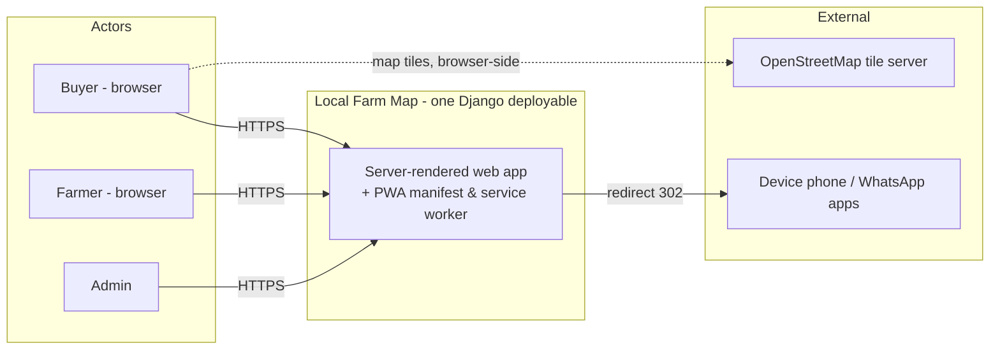
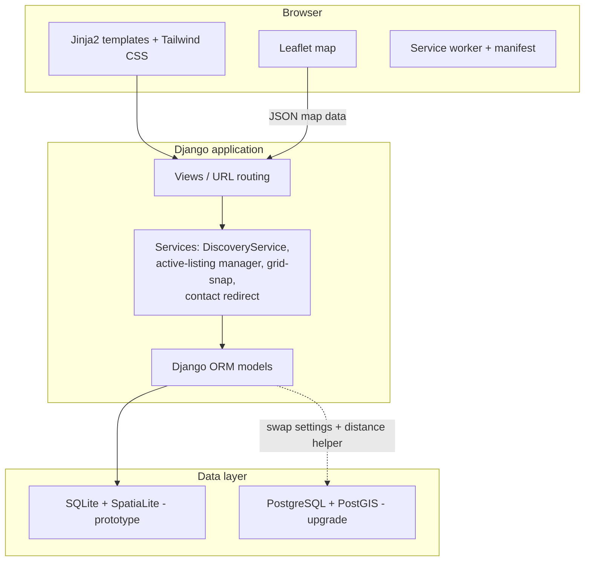
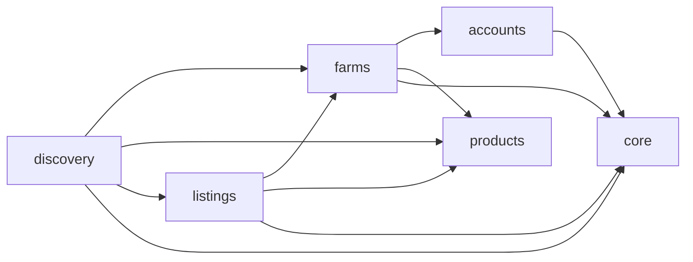

# Local Farm Map — System Design Document (SDD), V1

**Version 1.0 · 17 November 2026 · Status: for approval**
Scope: **A — Lean** (components & architecture only, by owner decision). Field-level data design → [database-design.md](../database/database-design.md) · Screens, journeys & wireframes → UI/UX Design Document (item 02 — next in this design queue; implementation begins only after it lands) · Requirements → [SRS v1.0](../../docs/Local_Farm_Map_SRS_v1.0.docx)

---

## 1. Purpose

Describe how Local Farm Map V1 is structured — the deployable unit, its modules, the key services, and the cross-cutting rules that keep them clean — so a builder can scaffold the project and know exactly where every feature lives without asking.

## 2. System context

One deployable, **one external runtime dependency** (OpenStreetMap tiles). Everything else — authentication, map data, contact logging — runs inside the Django application. Phone and WhatsApp are device-level handoffs (`tel:` / `wa.me`), not integrations; there is no messaging service in V1.

## 3. Architecture overview

Server-rendered HTML (Jinja2 + compiled Tailwind) with a Leaflet map in the browser, **plus one JSON endpoint** that feeds the map its farm/listing data (Leaflet needs JS objects, not server-rendered markup). Farmer authentication uses Django sessions.

## 4. Django apps (module map)

Six apps, extending the SRS A.1 suggestion with the buyer-side contact flow.

| App | Owns | Key rules |
|---|---|---|
| `core` | Landing page, navigation, shared base template, web manifest & service-worker files | imports nothing app-specific; every app uses its base template |
| `accounts` | Custom `User` (phone = `USERNAME_FIELD`, password auth — DB doc §4.3), registration, login/logout, role checks | farmers-only via `@login_required`; admin via `is_staff` |
| `farms` | `Farm` CRUD, products M2M, pickup hours, location privacy flag | grid-snap recomputes `public_location` on every save; `is_active` defaults to false — the farm stays out of discovery until an admin activates it at onboarding (curated pilot, per the proposal's rollout) |
| `products` | `Product` catalogue + seed migration (eggs, milk, honey, vegetables) | deactivate, never delete (listings reference products) |
| `listings` | `Listing`, active-listing manager, per-day upsert, farmer dashboard query | renewal = upsert on `(farm, product, listing_date)` |
| `discovery` | Buyer side: location input (GPS or `Place` picker), product filter, map JSON endpoint, farm detail view, contact redirect + `ContactEvent` | the only place buyer-facing queries run |

`ContactEvent` lives in `discovery` (*my call* — it is a buyer-initiated flow, not farm management).

**Dependency rules** (enforced by review, optionally `importlinter`):

`discovery` is a leaf — nothing imports it. No app imports another app's models except through the arrows above; services are called, never reached into.

## 5. Key services

The four places where the important logic concentrates:

1. **DiscoveryService** — the *only* module with spatial SQL. Input: origin point, product, radius. Output: farms with public pins + active listings. Honors `show_exact_pin` for pin choice, excludes farms with deactivated owners, implements the SRID strategy from DB doc §10 (UTM transform on SpatiaLite, geography cast on PostGIS).
2. **Active-listing manager** — default queryset `expires_at > now() AND withdrawn_at IS NULL`. Every buyer-facing view goes through it: freshness by query, never by scheduled job (SRS 5.4).
3. **Grid-snap helper** — rounds farm coordinates to ~1 km on save to regenerate `public_location` (DB doc §4.1).
4. **Contact redirect** — `GET /contact/{farm}/{channel}` → insert `ContactEvent` → 302 to `tel:` / `wa.me` (DB doc §5.6).
5. **Pilot report** — a Django management command (`manage.py pilot_report`) printing the weekly numbers the pilot's go/no-go gate needs: farmer listing activity (DB doc Q4) and buyer contact counts (Q5). *My call:* a command, not a dashboard — the gate needs numbers, not UI.

## 6. Cross-cutting rules

- **Auth:** Django sessions; farmer views require login; admin functions require `is_staff` (Django admin, FR-36).
- **Templates:** Jinja2 backend configured explicitly in `TEMPLATES`; no Django-template features assumed inside Jinja (SRS 7.1).
- **CSS:** Tailwind compiled at build time into one stylesheet — no runtime CDN, for bandwidth and offline (NFR-03).
- **PWA:** manifest + service worker served from `core`. The worker caches compiled static assets only; map/listing data is always network-first and, when served from cache while offline, displayed as possibly outdated — never as live availability (FR-34, NFR-09). Internal design of the worker is implementation detail.
- **Time:** `USE_TZ = True`; pilot timezone Africa/Nairobi pending pilot-area confirmation (DB doc §9).
- **Privacy:** public querysets never select `farm.location` or contact fields; contact numbers appear only on the farm detail view (NFR-05/06).
- **Language:** English-only copy in V1 (*my call*, conversation 17 Nov); Django's i18n/l10n is enabled at project setup so Kiswahili is a fast-follow, not a retrofit.

## 7. Deployment view

*My call (conversation, 17 Nov):* one small VPS.

- nginx terminates TLS and serves static files → gunicorn → Django (systemd units).
- SQLite/SpatiaLite database file on disk; nightly file-copy backup.
- Optional systemd timer tidies very old listings — correctness never depends on it (SRS 5.4).
- PostGIS upgrade = change `DATABASES` + swap the DiscoveryService distance helper (DB doc §10).
- Free-tier PaaS was rejected: instances spin down (bad for a live pilot) or make SpatiaLite awkward.

## 8. Approaches considered

| Decision | Options | Choice & why |
|---|---|---|
| SDD scope | **A** lean components-only / **B** full (+URL catalogue, interface contracts, FR traceability) / **C** B + UML sequence diagrams | **A — owner chose lean.** `design/UML/` can be filled by a separate diagrams doc later if wanted |
| Hosting | small VPS / free-tier PaaS | VPS — availability and SpatiaLite simplicity for ~$5/month |
| Module map | SRS A.1 six apps / add a seventh `contact` app | six apps; contact flow folded into `discovery` — too small to justify an app |
| Farmer onboarding | open self-registration, instantly public / curated admin activation gate | **curated** — the proposal's rollout onboards farms in person; `Farm.is_active` (default off) + discovery filter |
| Pilot metrics delivery | ad hoc SQL / management command / staff dashboard | management command `pilot_report` — weekly numbers with zero UI work |

## 9. Deliberately deferred (by the lean scope)

Where the missing detail will live instead:

| Deferred | Lands in |
|---|---|
| URL catalogue & JSON interface contracts | implementation plan |
| Wireframes, navigation, journeys | UI/UX doc (item 02) |
| FR → module traceability matrix | test/acceptance plan |
| Service-worker internals | implementation |

## References

- [System Proposal](../../docs/System%20Proposal%20Local%20Farm%20Map.pdf) · [SRS v1.0](../../docs/Local_Farm_Map_SRS_v1.0.docx) · [Database design](../database/database-design.md)
