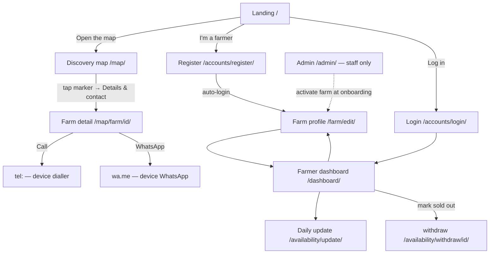

# Local Farm Map — UI/UX Design (V1)

**Version 1.0 · 18 November 2026 · Status: for approval**
Sources: [SRS v1.0](../../docs/Local_Farm_Map_SRS_v1.0.docx) (esp. §4.1 UI, §4.2 map, UC-01..04, NFR-01..09) · implemented screens in [farmconnect/templates/](../../farmconnect/templates/) · pilot area: **Kisii University** (owner, 17 Nov 2026). The wireframes below describe the screens *as built*; deviations from the SRS are listed in §8.

---

## 1. Purpose and intent

Define the screens, navigation structure, user journeys and wireframes for Local Farm Map V1 so that design, implementation and testing share one reference. The UI has one governing tension: **buyers need confidence at a glance** (what's fresh, where, how far), while **farmers need speed on a small phone** (the daily update in under 10 seconds, FR-19).

## 2. Design principles (from the SRS — non-negotiable)

| # | Principle | Source |
|---|---|---|
| P1 | Mobile-first, single column, map leads the home screen | SRS 4.1 |
| P2 | Farmer's daily update is the most important screen; under 10 seconds, minimal typing | SRS 1.3, FR-19 |
| P3 | No unnecessary images, animations or heavy assets | SRS 4.1, NFR-03 |
| P4 | Big touch targets on small screens | SRS 4.1 |
| P5 | Approximate pin is the visible default; exact pin only on opt-in, phone numbers only behind a tap | BR-08, NFR-05/06 |
| P6 | Offline/cached data is never presented as confirmed live availability | FR-34, NFR-09 |
| P7 | Every empty or failed state is actionable — tell the user what to try next | SRS UC-01 alt flow |

## 3. Information architecture & navigation

Two parallel tracks sharing one map page. Buyers never need an account (BR-03); everything behind `/dashboard/` requires login (FR-04).



Global navigation is a single top bar: brand → home; buyers see *Find food / Farmer sign up / Log in*; signed-in farmers see *Dashboard* and *Log out*. No hamburger menus — every destination is one tap away.

## 4. User journeys

### 4.1 Buyer — "find fresh food near me" (UC-01 + UC-04)

```
open /map/ ──► map centred on Kisii University
    │              (view is ALWAYS set — tiles never blank)
    ▼
pick area [Kisii University ▾] + [Search]   OR   [Use my location]
    │                                              │ (permission denied →
    ▼                                              │  actionable message,
tap a product chip (All/Eggs/Honey/Milk/Vegetables) │  falls back to areas)
    ▼                                              ▼
markers appear ── tap marker ──► popup: farm, products+prices, hours
    │                                │
    ▼                                └── "Details & contact" link
farm detail page: listings, hours, phone shown here (only here)
    │
tap [Call] or [WhatsApp] ──► ContactEvent logged ──► device app opens
    │
arrange pickup ──► pay at the farm gate (BR-09: platform holds no money)
```

Success target: a buyer finds a farm selling a chosen product in **under 30 seconds** (NFR-01) — one page, at most two taps (area+Search, marker).

### 4.2 Farmer — first time (UC-02)

```
landing ──► [I'm a farmer] ──► register (name, phone, password ×2)
    │ auto-login, "Now create your farm profile"
    ▼
farm profile: name, lat/lng, pickup hours, contact & WhatsApp phone,
    │ [ ] allow exact pin (OFF by default — P5)
    ▼ saved → dashboard shows "Waiting for onboarding"
(admin activates the farm during in-person onboarding — SDD §8)
    ▼
dashboard: "Visible to buyers" + [Update today's availability]
```

### 4.3 Farmer — every morning (UC-03, the <10 s screen)

```
dashboard ──► [Update today's availability]  (one big button, top of page)
    ▼
toggle what you have (pre-checked from yesterday's rows)
optional: price per item, quantity note
    ▼
[SAVE AVAILABILITY]  ──► flash "Availability saved: 2 new, 1 renewed"
untoggled items are marked sold out immediately
```

Target: **under 10 seconds** — toggles only, price optional, one save. Renewal is an upsert, so repeating yesterday takes 2 taps (open, save).

## 5. Screen inventory & wireframes

Nine screens. All share the top nav and a single-column main area (max ~34rem). Flash messages appear as full-width banners under the nav.

### 5.1 Landing (`/`) — convince in one glance

```
┌──────────────────────────────────────┐
│ Local Farm Map   Find food · Sign up │
├──────────────────────────────────────┤
│                                      │
│   Fresh food, from farms near you    │
│   See which farms near you have      │
│   eggs, milk, honey or vegetables    │
│   available today. Call or WhatsApp  │
│   the farmer, pick up at the gate.   │
│                                      │
│  [ Open the map ]  [ I'm a farmer ]  │
│                                      │
└──────────────────────────────────────┘
```

### 5.2 Discovery map (`/map/`) — the buyer's home

```
┌──────────────────────────────────────┐
│ Local Farm Map   Find food · Sign up │
├──────────────────────────────────────┤
│ (All) (Eggs) (Honey) (Milk) (Veg)    │ ← chips, active = filled
│ ┌──────────────┐┌──────┐┌───────────┐│
│ │ Kisii Univ ▾ ││Search││Use my loc.││ ← location row (§8-C1)
│ └──────────────┘└──────┘└───────────┘│
├──────────────────────────────────────┤
│                                      │
│           MAP  (~65% of screen)      │
│      ●  green dot = approximate pin  │
│      ●  amber dot = exact (opted in) │
│   tap dot → popup with products,     │
│   prices, hours, [Details & contact] │
│                                      │
├──────────────────────────────────────┤
│ (empty state banner — only when 0    │
│  results; always names a next step)  │
└──────────────────────────────────────┘
```

States: **no results** → "No farms found with active listings here today. Try another product or place." · **offline/failed** → "Could not reach the server — showing possibly outdated data is not possible offline." (P6) · **GPS denied** → "Could not get your location (permission denied?). Choose an area and press Search."

### 5.3 Farm detail (`/map/farm/{id}/`) — trust + handoff

```
┌──────────────────────────────────────┐
│ Amina Fresh Shamba                   │
│ ℹ Approximate location shown (about  │
│   1 km wide) to protect the farmer's │
│   home. Exact directions after call. │
├──────────────────────────────────────┤
│ Available today                      │
│  • Eggs — KES 400 (10 trays)         │
│  • Milk — ask the farmer             │
│ Pickup hours: Mon-Sat, 7am-6pm       │
├──────────────────────────────────────┤
│ Contact the farmer                   │
│ Phone: +254 700 000 0101             │ ← shown ONLY here (FR-30)
│ You arrange pickup directly and pay  │
│ at the farm gate.                    │
│ ┌──────────────────────────────────┐ │
│ │            Call                  │ │
│ ├──────────────────────────────────┤ │
│ │           WhatsApp               │ │ ← full-width, ≥44px (P4)
│ └──────────────────────────────────┘ │
└──────────────────────────────────────┘
```

### 5.4 Farmer dashboard (`/dashboard/`) — one hero action

```
┌──────────────────────────────────────┐
│ Amina Fresh Shamba                   │
│ ┌──────────────────────────────────┐ │
│ │ Waiting for onboarding — an      │ │  ← or "Visible to buyers"
│ │ admin will activate your farm    │ │     status banner
│ │ before buyers can see it.        │ │
│ └──────────────────────────────────┘ │
│ [ UPDATE TODAY'S AVAILABILITY ]      │ ← primary, large
│ [ Edit farm profile ]                │
│                                      │
│ Today (2 listings)                   │
│  • Eggs — KES 400 (10 trays)         │
│    [mark sold out]                   │
│  • Milk — ask the farmer [sold out]  │
└──────────────────────────────────────┘
```

### 5.5 Daily update (`/availability/update/`) — the 10-second screen

```
┌──────────────────────────────────────┐
│ What's available today?              │
│ Toggle what you have today… Listings │
│ expire automatically at midnight.    │
├──────────────────────────────────────┤
│ ☑ Available today   EGGS  (per tray) │ ← pre-checked if listed
│   Price (KES, optional)  [ 400 ]     │
│   Quantity note          [10 trays]  │
├──────────────────────────────────────┤
│ ☐ Available today   MILK (per litre) │
│   Price …              [      ]      │
├──────────────────────────────────────┤
│ ☐ HONEY      ☐ VEGETABLES            │
├──────────────────────────────────────┤
│ [    SAVE AVAILABILITY     ]         │ ← one tap to finish
└──────────────────────────────────────┘
```

### 5.6–5.9 Forms — register, login, farm profile, farm-not-found

Stacked labelled fields, full-width inputs, visible errors under each field, one large submit button.

```
register:                farm profile:
  Name [        ]          Farm name [        ]
  Phone [        ]         Latitude [   ] Longitude [   ]
  Password [    ]          Pickup hours [        ]
  Repeat [      ]          Contact phone [    ]
  [ Create account ]       WhatsApp [    ] (blank = same)
                           ☐ Allow buyers to see my exact farm pin
                           [ Save profile ]
```

Farm-not-found (404) and login/register pages follow the same shell; farm-not-found offers one link back to the map.

## 6. Visual language (deliberately minimal)

- **Palette:** single brand green `#166534` (nav, primary buttons, chips, approximate-pin dots), amber `#b45309` for exact-pin dots, soft grey/cream surfaces. Semantics: filled chip = active filter; green dot = privacy default; amber dot = farmer opted in.
- **Type & assets:** system font stack, no webfonts, no photos, no icons beyond the PWA SVG. Total CSS is one small stylesheet; the Tailwind build step (SDD §6) replaces it before pilot launch.
- **Feedback:** flash banners for saves/errors; markers + popups for map data; status banner for onboarding state. No modals anywhere.

## 7. Requirements traceability

| Screen | SRS refs |
|---|---|
| Landing | BR-03, UC-01 entry |
| Discovery map | FR-20..27, NFR-01/03/08, UC-01 |
| Farm detail | FR-26, FR-28..31, NFR-06, UC-04 |
| Dashboard | FR-18, BR-08 messaging, UC-03 entry |
| Daily update | FR-12..19, NFR-02, UC-03 |
| Farm profile | FR-05..10, UC-02 |
| Register/Login | FR-01..04, UC-02 |
| Admin (out of scope of this doc) | FR-35/36 — Django admin, SDD §4 |

## 8. My calls (veto any)

1. **Location = select + [Search] + [Use my location]** — supersedes the plain picker; the button makes the action explicit and the URL stays shareable (`/map/?place=kisii-university`). As built 17 Nov.
2. **Circle markers with colour semantics** (green/amber) instead of pin icons — no image assets, privacy legible at a glance.
3. **Single-column, max ~34rem content width** — long lines on phones are the main readability risk; the map itself runs full-width.
4. **Phone number displayed as text on farm detail** — SRS FR-30 says reveal behind a tap; the detail page *is* the tap. Call/WhatsApp buttons are separate actions (logged for pilot metrics).
5. **English-only copy**, strings kept i18n-ready (SDD §6).
6. **No images, no modals, no client-side routing** — server-rendered pages keep offline behaviour honest and payloads tiny.
7. **Status banner instead of email/notifications** for "waiting for onboarding" — the farmer sees state at login, nothing to build.
8. **Empty/failed states always instruct** — every dead end names the next action (P7).

## 9. Known gaps / next iteration (post-pilot, not V1)

Kiswahili translation · farm photos · reviews (proposal V2) · saved areas & push-style harvest alerts (V2) · map clustering if farm density grows.

## References

[Database design](../database/database-design.md) · [SDD](../system/system-design.md) · [UML set](../UML/README.md) · templates: `farmconnect/templates/{core,accounts,farms,listings,discovery}/`
